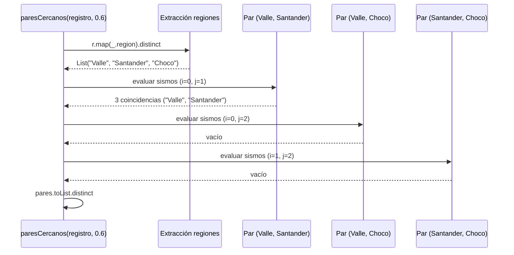

# Punto 1 - Consultas con Expresiones `for`
## Definición de los Algoritmos

```Scala
def fuertes(r: Registro, umbral: Double): List[String] =
  for {
    sismo <- r
    if sismo.magnitud > umbral
  } yield sismo.region

def enRegion(r: Registro, region: String): List[Double] =
  for {
    sismo <- r
    if sismo.region == region
  } yield sismo.magnitud

def paresCercanos(r: Registro, dif: Double): List[(String, String)] = {
  val regiones = (for {
    sismo <- r
  } yield sismo.region).distinct

  val pares = for {
    i <- 0 until regiones.length
    j <- (i + 1) until regiones.length
    reg1 = regiones(i)
    reg2 = regiones(j)
    sismo1 <- r
    if sismo1.region == reg1
    sismo2 <- r
    if sismo2.region == reg2
    if (sismo1.magnitud - sismo2.magnitud).abs <= dif
  } yield (reg1, reg2)

  pares.toList.distinct
}
```

- La función `fuertes` obtiene las regiones de los sismos cuya magnitud supera estrictamente el `umbral`, conservando el orden original y los repetidos.
- La función `enRegion` extrae las magnitudes registradas para una `region` específica.
- La función `paresCercanos` encuentra las parejas de regiones distintas cuyos sismos tienen una diferencia absoluta de magnitud menor o igual a `dif`, evitando duplicados simétricos y respetando el orden de aparición en el registro:
    - `regiones`: lista de regiones únicas en su orden de aparición.
    - `pares`: combinaciones ordenadas `(reg1, reg2)` generadas a partir de índices `i < j`.

---

## Traducción de las Expresiones `for`

El compilador de Scala traduce cada expresión `for` antes de la verificación de tipos a llamadas de métodos de orden superior (`map`, `flatMap` y `withFilter`).

### Traducción de `fuertes`

```Scala
r.withFilter(sismo => sismo.magnitud > umbral)
 .map(sismo => sismo.region)
```

- `withFilter` filtra de manera perezosa los sismos que cumplen `sismo.magnitud > umbral` sin crear colecciones intermedias.
- `map` transforma cada sismo filtrado en su atributo `region`.

### Traducción de `enRegion`

```Scala
r.withFilter(sismo => sismo.region == region)
 .map(sismo => sismo.magnitud)
```

- `withFilter` selecciona únicamente los sismos donde `sismo.region == region`.
- `map` extrae el atributo `magnitud` de cada elemento seleccionado.

### Traducción de `paresCercanos`

#### 1. Expresión `for` para obtener `regiones`

```Scala
val regiones = r.map(sismo => sismo.region).distinct
```

- Un único generador sin guarda se traduce directamente a `map`, seguido de `.distinct` para eliminar repetidos preservando el orden de primera aparición.

#### 2. Expresión `for` para obtener `pares`

```Scala
val pares = (0 until regiones.length).flatMap { i =>
  ((i + 1) until regiones.length)
    .map { j =>
      val reg1 = regiones(i)
      val reg2 = regiones(j)
      (j, reg1, reg2)
    }
    .flatMap { case (j, reg1, reg2) =>
      r.withFilter(sismo1 => sismo1.region == reg1)
       .flatMap { sismo1 =>
         r.withFilter(sismo2 => sismo2.region == reg2)
          .withFilter(sismo2 => (sismo1.magnitud - sismo2.magnitud).abs <= dif)
          .map(_ => (reg1, reg2))
       }
    }
}
```

- Las definiciones intermedias `reg1 = regiones(i)` y `reg2 = regiones(j)` se traducen mediante un `.map` que agrupa el índice `j` con los valores calculados en una tupla.
- Cada condición `if` se traduce en una llamada a `.withFilter`.
- Cada generador externo (`i`, `j`, `sismo1`) se traduce a `.flatMap`, mientras que el último generador (`sismo2`) se traduce a `.map`.

---

## Explicación paso a paso

### Ejecución de `fuertes`

```Scala
if sismo.magnitud > umbral
```

En cada elemento del registro:
- Se evalúa si su magnitud supera `umbral`.
- Si cumple, su región se añade a la lista resultante; de lo contrario, se ignora.

### Ejecución de `enRegion`

```Scala
if sismo.region == region
```

En cada elemento del registro:
- Se compara `sismo.region` con el parámetro `region`.
- Si coinciden, se proyecta `sismo.magnitud`.

### Ejecución de `paresCercanos`

1. Se extraen las regiones únicas en orden de aparición (`regiones`).
2. Se generan pares de índices `i < j` sobre `regiones` para garantizar que `reg1` apareció antes que `reg2` y que nunca se evalúe una pareja simétrica `(reg2, reg1)`.
3. Para cada par `(reg1, reg2)`, se cruzan los sismos de `reg1` con los sismos de `reg2` verificando `(sismo1.magnitud - sismo2.magnitud).abs <= dif`.
4. Se convierte el resultado a lista y se aplica `.distinct` para dejar una sola ocurrencia por pareja.

---

## Traza de ejecución paso a paso

Ejemplo con `registro` (7 sismos):

```Scala
fuertes(registro, 5.0)
```

### Paso 1: Sismo 1 (`"Valle"`, `4.2`)

```Scala
4.2 > 5.0 // false -> descartado
```

### Paso 2: Sismo 2 (`"Santander"`, `5.1`)

```Scala
5.1 > 5.0 // true -> acumulado: List("Santander")
```

### Paso 3: Sismo 3 (`"Valle"`, `3.8`)

```Scala
3.8 > 5.0 // false -> descartado
```

### Paso 4: Sismo 4 (`"Choco"`, `6.0`)

```Scala
6.0 > 5.0 // true -> acumulado: List("Santander", "Choco")
```

### Paso 5: Sismo 5 (`"Santander"`, `4.7`)

```Scala
4.7 > 5.0 // false -> descartado
```

### Paso 6: Sismo 6 (`"Valle"`, `5.3`)

```Scala
5.3 > 5.0 // true -> acumulado: List("Santander", "Choco", "Valle")
```

### Paso 7: Sismo 7 (`"Choco"`, `3.1`)

```Scala
3.1 > 5.0 // false -> descartado
```

### Paso 8: Retorno

```Scala
return List("Santander", "Choco", "Valle")
```

---

### Traza de `paresCercanos(registro, 0.6)`

### Paso 1: Extracción de regiones únicas

```Scala
regiones = List("Valle", "Santander", "Choco")
```

### Paso 2: Combinación `i = 0, j = 1` (`"Valle"`, `"Santander"`)

```Scala
// Sismos Valle: [4.2, 3.8, 5.3] | Sismos Santander: [5.1, 4.7]
(4.2 - 4.7).abs <= 0.6 // true (0.5 <= 0.6) -> emite ("Valle", "Santander")
(5.3 - 5.1).abs <= 0.6 // true (0.2 <= 0.6) -> emite ("Valle", "Santander")
(5.3 - 4.7).abs <= 0.6 // true (0.6 <= 0.6) -> emite ("Valle", "Santander")
```

### Paso 3: Combinación `i = 0, j = 2` (`"Valle"`, `"Choco"`)

```Scala
// Sismos Valle: [4.2, 3.8, 5.3] | Sismos Choco: [6.0, 3.1]
// Diferencia mínima: (3.8 - 3.1).abs = 0.7 > 0.6 -> no emite nada
```

### Paso 4: Combinación `i = 1, j = 2` (`"Santander"`, `"Choco"`)

```Scala
// Sismos Santander: [5.1, 4.7] | Sismos Choco: [6.0, 3.1]
// Diferencia mínima: (5.1 - 6.0).abs = 0.9 > 0.6 -> no emite nada
```

### Paso 5: Deduplicación y retorno

```Scala
pares.toList.distinct // return List(("Valle", "Santander"))
```

---

## Diferencia con ciclos imperativos tradicionales

- En un **enfoque imperativo** se requieren variables mutables, acumuladores externos y bucles anidados explícitos que describen *cómo* recorrer índices y controlar duplicados manualmente.
- Con **expresiones `for`**, el código es puramente declarativo: describe *qué* propiedades deben cumplir los elementos y delega el recorrido a combinadores de orden superior sin estado mutable.

---

## Ejemplo de uso

```Scala
val r1 = fuertes(registro, 5.0)
println(r1) // List(Santander, Choco, Valle)

val r2 = enRegion(registro, "Valle")
println(r2) // List(4.2, 3.8, 5.3)

val r3 = paresCercanos(registro, 0.6)
println(r3) // List((Valle,Santander))
```

---

## Diagrama de flujo de ejecución en `paresCercanos`

