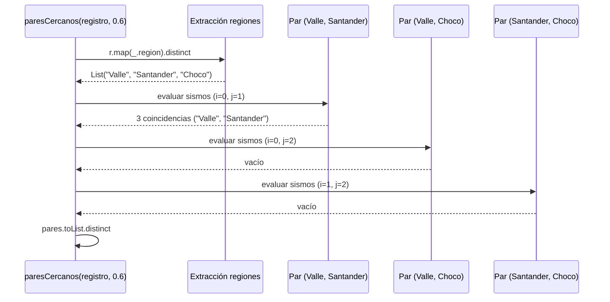
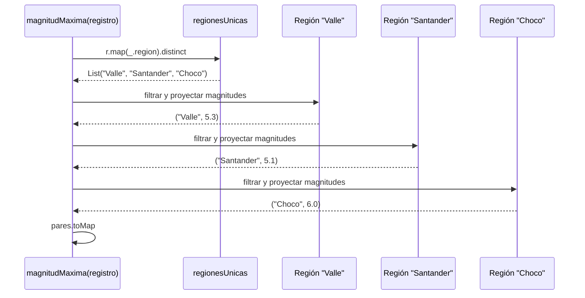
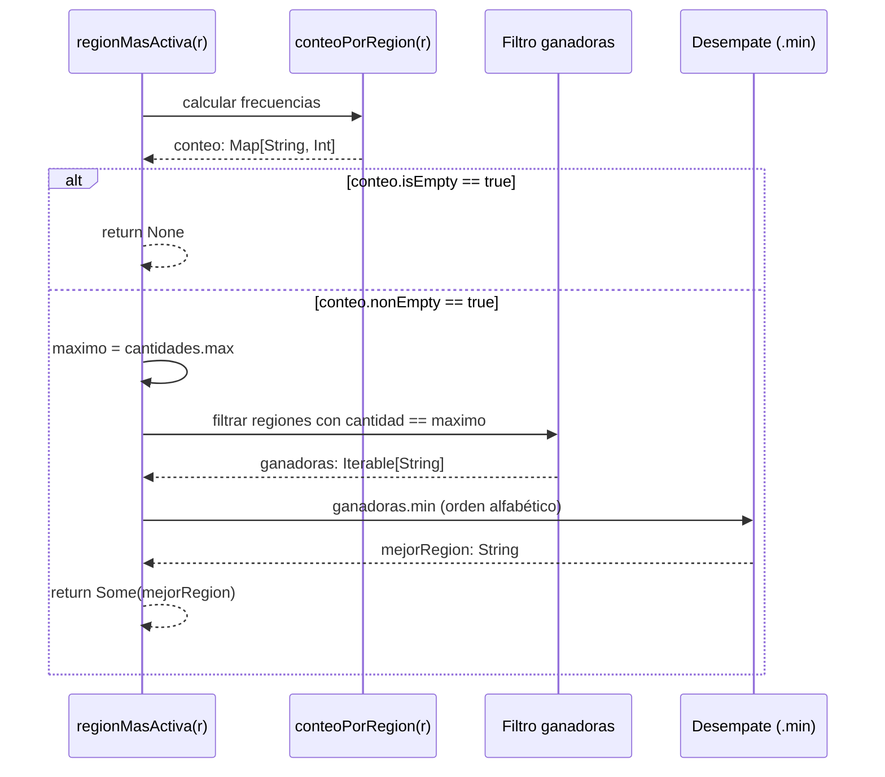

# Punto 1 - Consultas con Expresiones `for`
## Definición de los Algoritmos

```Scala
def fuertes(r: Registro, umbral: Double): List[String] =
  for {
    sismo <- r
    if sismo.magnitud > umbral
  } yield sismo.region

def enRegion(r: Registro, region: String): List[Double] =
  for {
    sismo <- r
    if sismo.region == region
  } yield sismo.magnitud

def paresCercanos(r: Registro, dif: Double): List[(String, String)] = {
  val regiones = (for {
    sismo <- r
  } yield sismo.region).distinct

  val pares = for {
    i <- 0 until regiones.length
    j <- (i + 1) until regiones.length
    reg1 = regiones(i)
    reg2 = regiones(j)
    sismo1 <- r
    if sismo1.region == reg1
    sismo2 <- r
    if sismo2.region == reg2
    if (sismo1.magnitud - sismo2.magnitud).abs <= dif
  } yield (reg1, reg2)

  pares.toList.distinct
}
```

- La función `fuertes` obtiene las regiones de los sismos cuya magnitud supera estrictamente el `umbral`, conservando el orden original y los repetidos.
- La función `enRegion` extrae las magnitudes registradas para una `region` específica.
- La función `paresCercanos` encuentra las parejas de regiones distintas cuyos sismos tienen una diferencia absoluta de magnitud menor o igual a `dif`, evitando duplicados simétricos y respetando el orden de aparición en el registro:
    - `regiones`: lista de regiones únicas en su orden de aparición.
    - `pares`: combinaciones ordenadas `(reg1, reg2)` generadas a partir de índices `i < j`.

---

## Traducción de las Expresiones `for`

El compilador de Scala traduce cada expresión `for` antes de la verificación de tipos a llamadas de métodos de orden superior (`map`, `flatMap` y `withFilter`).

### Traducción de `fuertes`

```Scala
r.withFilter(sismo => sismo.magnitud > umbral)
 .map(sismo => sismo.region)
```

- `withFilter` filtra de manera perezosa los sismos que cumplen `sismo.magnitud > umbral` sin crear colecciones intermedias.
- `map` transforma cada sismo filtrado en su atributo `region`.

### Traducción de `enRegion`

```Scala
r.withFilter(sismo => sismo.region == region)
 .map(sismo => sismo.magnitud)
```

- `withFilter` selecciona únicamente los sismos donde `sismo.region == region`.
- `map` extrae el atributo `magnitud` de cada elemento seleccionado.

### Traducción de `paresCercanos`

#### 1. Expresión `for` para obtener `regiones`

```Scala
val regiones = r.map(sismo => sismo.region).distinct
```

- Un único generador sin guarda se traduce directamente a `map`, seguido de `.distinct` para eliminar repetidos preservando el orden de primera aparición.

#### 2. Expresión `for` para obtener `pares`

```Scala
val pares = (0 until regiones.length).flatMap { i =>
  ((i + 1) until regiones.length)
    .map { j =>
      val reg1 = regiones(i)
      val reg2 = regiones(j)
      (j, reg1, reg2)
    }
    .flatMap { case (j, reg1, reg2) =>
      r.withFilter(sismo1 => sismo1.region == reg1)
       .flatMap { sismo1 =>
         r.withFilter(sismo2 => sismo2.region == reg2)
          .withFilter(sismo2 => (sismo1.magnitud - sismo2.magnitud).abs <= dif)
          .map(_ => (reg1, reg2))
       }
    }
}
```

- Las definiciones intermedias `reg1 = regiones(i)` y `reg2 = regiones(j)` se traducen mediante un `.map` que agrupa el índice `j` con los valores calculados en una tupla.
- Cada condición `if` se traduce en una llamada a `.withFilter`.
- Cada generador externo (`i`, `j`, `sismo1`) se traduce a `.flatMap`, mientras que el último generador (`sismo2`) se traduce a `.map`.

---

## Explicación paso a paso

### Ejecución de `fuertes`

```Scala
if sismo.magnitud > umbral
```

En cada elemento del registro:
- Se evalúa si su magnitud supera `umbral`.
- Si cumple, su región se añade a la lista resultante; de lo contrario, se ignora.

### Ejecución de `enRegion`

```Scala
if sismo.region == region
```

En cada elemento del registro:
- Se compara `sismo.region` con el parámetro `region`.
- Si coinciden, se proyecta `sismo.magnitud`.

### Ejecución de `paresCercanos`

1. Se extraen las regiones únicas en orden de aparición (`regiones`).
2. Se generan pares de índices `i < j` sobre `regiones` para garantizar que `reg1` apareció antes que `reg2` y que nunca se evalúe una pareja simétrica `(reg2, reg1)`.
3. Para cada par `(reg1, reg2)`, se cruzan los sismos de `reg1` con los sismos de `reg2` verificando `(sismo1.magnitud - sismo2.magnitud).abs <= dif`.
4. Se convierte el resultado a lista y se aplica `.distinct` para dejar una sola ocurrencia por pareja.

---

## Traza de ejecución paso a paso

Ejemplo con `registro` (7 sismos):

```Scala
fuertes(registro, 5.0)
```

### Paso 1: Sismo 1 (`"Valle"`, `4.2`)

```Scala
4.2 > 5.0 // false -> descartado
```

### Paso 2: Sismo 2 (`"Santander"`, `5.1`)

```Scala
5.1 > 5.0 // true -> acumulado: List("Santander")
```

### Paso 3: Sismo 3 (`"Valle"`, `3.8`)

```Scala
3.8 > 5.0 // false -> descartado
```

### Paso 4: Sismo 4 (`"Choco"`, `6.0`)

```Scala
6.0 > 5.0 // true -> acumulado: List("Santander", "Choco")
```

### Paso 5: Sismo 5 (`"Santander"`, `4.7`)

```Scala
4.7 > 5.0 // false -> descartado
```

### Paso 6: Sismo 6 (`"Valle"`, `5.3`)

```Scala
5.3 > 5.0 // true -> acumulado: List("Santander", "Choco", "Valle")
```

### Paso 7: Sismo 7 (`"Choco"`, `3.1`)

```Scala
3.1 > 5.0 // false -> descartado
```

### Paso 8: Retorno

```Scala
return List("Santander", "Choco", "Valle")
```

---

### Traza de `paresCercanos(registro, 0.6)`

### Paso 1: Extracción de regiones únicas

```Scala
regiones = List("Valle", "Santander", "Choco")
```

### Paso 2: Combinación `i = 0, j = 1` (`"Valle"`, `"Santander"`)

```Scala
// Sismos Valle: [4.2, 3.8, 5.3] | Sismos Santander: [5.1, 4.7]
(4.2 - 4.7).abs <= 0.6 // true (0.5 <= 0.6) -> emite ("Valle", "Santander")
(5.3 - 5.1).abs <= 0.6 // true (0.2 <= 0.6) -> emite ("Valle", "Santander")
(5.3 - 4.7).abs <= 0.6 // true (0.6 <= 0.6) -> emite ("Valle", "Santander")
```

### Paso 3: Combinación `i = 0, j = 2` (`"Valle"`, `"Choco"`)

```Scala
// Sismos Valle: [4.2, 3.8, 5.3] | Sismos Choco: [6.0, 3.1]
// Diferencia mínima: (3.8 - 3.1).abs = 0.7 > 0.6 -> no emite nada
```

### Paso 4: Combinación `i = 1, j = 2` (`"Santander"`, `"Choco"`)

```Scala
// Sismos Santander: [5.1, 4.7] | Sismos Choco: [6.0, 3.1]
// Diferencia mínima: (5.1 - 6.0).abs = 0.9 > 0.6 -> no emite nada
```

### Paso 5: Deduplicación y retorno

```Scala
pares.toList.distinct // return List(("Valle", "Santander"))
```

---

## Diferencia con ciclos imperativos tradicionales

- En un **enfoque imperativo** se requieren variables mutables, acumuladores externos y bucles anidados explícitos que describen *cómo* recorrer índices y controlar duplicados manualmente.
- Con **expresiones `for`**, el código es puramente declarativo: describe *qué* propiedades deben cumplir los elementos y delega el recorrido a combinadores de orden superior sin estado mutable.

---

## Ejemplo de uso

```Scala
val r1 = fuertes(registro, 5.0)
println(r1) // List(Santander, Choco, Valle)

val r2 = enRegion(registro, "Valle")
println(r2) // List(4.2, 3.8, 5.3)

val r3 = paresCercanos(registro, 0.6)
println(r3) // List((Valle,Santander))
```

---

## Diagrama de flujo de ejecución en `paresCercanos`



# Punto 2: agrupar con mapas

## Definición de los Algoritmos

```Scala
def porRegion(r: Registro): Map[String, List[Sismo]] = {
  val regionesUnicas = r.map(sismo => sismo.region).distinct
  val pares = for {
    region <- regionesUnicas
    sismosDeRegion = for (sismo <- r if sismo.region == region) yield sismo
  } yield (region, sismosDeRegion)
  
  pares.toMap
}

def conteoPorRegion(r: Registro): Map[String, Int] = {
  val regionesUnicas = r.map(sismo => sismo.region).distinct
  val pares = for {
    region <- regionesUnicas
    cantidad = (for (sismo <- r if sismo.region == region) yield sismo).length
  } yield (region, cantidad)

  pares.toMap
}

def magnitudMaxima(r: Registro): Map[String, Double] = {
  val regionesUnicas = r.map(sismo => sismo.region).distinct
  val pares = for {
    region <- regionesUnicas
    magnitudes = for (sismo <- r if sismo.region == region) yield sismo.magnitud
  } yield (region, magnitudes.max)

  pares.toMap
}
```

- La función `porRegion` construye un mapa inmutable `Map[String, List[Sismo]]` que asocia cada región presente en el registro con la sublista de sus sismos en orden de aparición.
- La función `conteoPorRegion` genera un mapa `Map[String, Int]` con la cantidad total de eventos sísmicos ocurridos en cada región registrada.
- La función `magnitudMaxima` produce un mapa `Map[String, Double]` con la mayor magnitud registrada por región:
  - `regionesUnicas`: secuencia sin duplicados de las regiones que aparecen en `r`.
  - `pares`: lista de tuplas `(clave, valor)` transformada finalmente en un mapa mediante `.toMap`.

---

## Traducción de las Expresiones `for`

El compilador de Scala desazucara cada expresión `for` en llamadas encadenadas a `map` y `withFilter` (*Programming in Scala*, Cap. 23).

### Traducción de `porRegion`

```Scala
val pares = regionesUnicas
  .map { region =>
    val sismosDeRegion = r.withFilter(sismo => sismo.region == region)
                          .map(sismo => sismo)
    (region, sismosDeRegion)
  }
  .map { case (region, sismosDeRegion) =>
    (region, sismosDeRegion)
  }
```

- El `for` interno (`for (sismo <- r if sismo.region == region) yield sismo`) se traduce a `r.withFilter(...).map(...)`.
- La asignación intermedia `sismosDeRegion = ...` dentro del `for` externo se traduce mediante un primer `.map` que empaqueta `(region, sismosDeRegion)`, seguido de un segundo `.map` correspondiente al `yield` final.

### Traducción de `conteoPorRegion`

```Scala
val pares = regionesUnicas
  .map { region =>
    val cantidad = r.withFilter(sismo => sismo.region == region)
                    .map(sismo => sismo)
                    .length
    (region, cantidad)
  }
  .map { case (region, cantidad) =>
    (region, cantidad)
  }
```

- El `for` interno filtra los sismos de `region`, proyecta la sublista y calcula su cardinalidad mediante `.length`.
- El resultado entero se empaqueta junto a `region` para ser convertido en `Map[String, Int]` con `.toMap`.

### Traducción de `magnitudMaxima`

```Scala
val pares = regionesUnicas
  .map { region =>
    val magnitudes = r.withFilter(sismo => sismo.region == region)
                      .map(sismo => sismo.magnitud)
    (region, magnitudes)
  }
  .map { case (region, magnitudes) =>
    (region, magnitudes.max)
  }
```

- El `for` interno filtra los sismos por región y proyecta únicamente el campo `magnitud` (`List[Double]`).
- El `yield` final aplica `.max` sobre `magnitudes` y construye la tupla `(region, Double)`.

---

## Explicación paso a paso

### Construcción del dominio de claves (`regionesUnicas`)

```Scala
val regionesUnicas = r.map(sismo => sismo.region).distinct
```

- Se proyecta el atributo `region` de todos los sismos en `r`.
- `.distinct` elimina repeticiones, garantizando que las regiones ausentes en `r` nunca aparezcan en el mapa y que si `r` es `Nil`, `regionesUnicas` sea `Nil` (produciendo `Map()`).

### Agrupación y reducción por clave

En las tres funciones, por cada `region` en `regionesUnicas`:
1. Se recorre `r` filtrando los sismos cuyo atributo `region` coincide con la clave actual.
2. Se aplica la operación de agregación correspondiente:
  - Identidad de lista (`List[Sismo]`) en `porRegion`.
  - Conteo de elementos (`.length`) en `conteoPorRegion`.
  - Máximo numérico (`.max`) en `magnitudMaxima`.
3. Se invoca `.toMap` sobre la lista de tuplas `List[(String, V)]` para construir el diccionario inmutable.

---

## Traza de ejecución paso a paso

Ejemplo con `registro` (7 sismos):

```Scala
magnitudMaxima(registro)
```

### Paso 1: Extracción de regiones únicas

```Scala
r.map(_.region) // List("Valle", "Santander", "Valle", "Choco", "Santander", "Valle", "Choco")
regionesUnicas  // List("Valle", "Santander", "Choco")
```

### Paso 2: Procesamiento de `region = "Valle"`

```Scala
magnitudes = List(4.2, 3.8, 5.3)
magnitudes.max // 5.3
// Tupla generada: ("Valle", 5.3)
```

### Paso 3: Procesamiento de `region = "Santander"`

```Scala
magnitudes = List(5.1, 4.7)
magnitudes.max // 5.1
// Tupla generada: ("Santander", 5.1)
```

### Paso 4: Procesamiento de `region = "Choco"`

```Scala
magnitudes = List(6.0, 3.1)
magnitudes.max // 6.0
// Tupla generada: ("Choco", 6.0)
```

### Paso 5: Construcción del mapa final

```Scala
List(("Valle", 5.3), ("Santander", 5.1), ("Choco", 6.0)).toMap
// return Map("Valle" -> 5.3, "Santander" -> 5.1, "Choco" -> 6.0)
```

---

### Traza de `conteoPorRegion(registro)`

### Paso 1: Regiones únicas

```Scala
regionesUnicas = List("Valle", "Santander", "Choco")
```

### Paso 2: Cálculo de cardinalidades por región

```Scala
"Valle"     -> List(s0, s2, s5).length = 3 -> ("Valle", 3)
"Santander" -> List(s1, s4).length     = 2 -> ("Santander", 2)
"Choco"     -> List(s3, s6).length     = 2 -> ("Choco", 2)
```

### Paso 3: Retorno

```Scala
pares.toMap // return Map("Valle" -> 3, "Santander" -> 2, "Choco" -> 2)
```

---

## Diferencia con agrupación mutable imperativa

- En un **enfoque imperativo** se instancia un `mutable.Map` vacío y se mutan sus entradas en cada iteración verificando manualmente si la clave ya existe (`contains`), incrementando contadores o reemplazando máximos con variables locales.
- En el **enfoque funcional**, el mapa se construye de una sola vez a partir de una colección inmutable de pares clave-valor `(K, V)`, garantizando ausencia de efectos secundarios e inmutabilidad estructural.

---

## Ejemplo de uso

```Scala
val m1 = porRegion(registro)
println(m1("Santander").length) // 2

val m2 = conteoPorRegion(registro)
println(m2) // Map(Valle -> 3, Santander -> 2, Choco -> 2)

val m3 = magnitudMaxima(registro)
println(m3) // Map(Valle -> 5.3, Santander -> 5.1, Choco -> 6.0)
```

---

## Diagrama de flujo de ejecución en `magnitudMaxima`



# Punto 3: consultas seguras

## Definición de los Algoritmos

```Scala
def conteoSeguro(r: Registro): Map[String, Int] =
  conteoPorRegion(r).withDefaultValue(0)

def maximaDe(r: Registro, region: String): Option[Double] =
  magnitudMaxima(r).get(region)

def regionMasActiva(r: Registro): Option[String] = {
  val conteo = conteoPorRegion(r)

  if (conteo.isEmpty) {
    None
  } else {
    val cantidades = for ((_, cantidad) <- conteo) yield cantidad
    val maximo = cantidades.max

    val ganadoras = for {
      (region, cantidad) <- conteo
      if cantidad == maximo
    } yield region

    Some(ganadoras.min)
  }
}
```

- La función `conteoSeguro` envuelve el mapa retornado por `conteoPorRegion(r)` con un valor por defecto (`0`) mediante `.withDefaultValue(0)`, evitando excepciones `NoSuchElementException` al consultar regiones inexistentes.
- La función `maximaDe` consulta `magnitudMaxima(r)` utilizando el método total `.get(region)`, retornando `Some(magnitud)` si la región existe o `None` si está ausente.
- La función `regionMasActiva` determina la región con mayor frecuencia de sismos de forma total:
  - Si `conteo.isEmpty`, retorna `None`.
  - Si hay registros, encuentra el máximo conteo (`maximo`), filtra las regiones empatadas (`ganadoras`) y selecciona la primera en orden alfabético (`ganadoras.min`) envuelta en `Some`.

---

## Traducción de las Expresiones `for`

El compilador de Scala traduce las expresiones `for` presentes en `regionMasActiva` a invocaciones de `map` y `withFilter` sobre el mapa `conteo: Map[String, Int]` (*Programming in Scala*, Cap. 23).

### Traducción de `cantidades`

```Scala
val cantidades = conteo.map { case (_, cantidad) => cantidad }
```

- Al iterar sobre un `Map[String, Int]`, cada elemento es una tupla `(String, Int)`.
- Un único generador con ajuste de patrones y sin filtro se traduce directamente a `.map`, produciendo un `Iterable[Int]`.

### Traducción de `ganadoras`

```Scala
val ganadoras = conteo
  .withFilter { case (region, cantidad) => cantidad == maximo }
  .map { case (region, cantidad) => region }
```

- La guarda `if cantidad == maximo` se desazucara en `.withFilter(...)`, filtrando las entradas del mapa sin construir colecciones intermedias.
- La cláusula `yield region` se traduce en `.map(...)`, proyectando únicamente las claves `String` de las regiones empatadas.

---

## Explicación paso a paso

### Totalidad mediante `withDefaultValue` y `Option`

1. **`conteoSeguro(r)`:**
  - El método `apply(key)` de un `Map` estándar invoca `default(key)`, el cual por defecto lanza `NoSuchElementException`.
  - `withDefaultValue(0)` retorna un decorador `Map.WithDefault` que sobrescribe `default(key)` para devolver `0` sin modificar las claves almacenadas en el mapa.

2. **`maximaDe(r, region)`:**
  - Transforma una función parcial ($K \rightharpoonup V$) en una función total ($K \to \text{Option}[V]$) mediante `.get(region)`.

3. **`regionMasActiva(r)`:**
  - **Paso 1:** Obtiene `conteo = conteoPorRegion(r)`.
  - **Paso 2:** Verifica `conteo.isEmpty`. Si es verdadero, corta la ejecución retornando `None` (evitando invocar `.max` o `.min` sobre colecciones vacías).
  - **Paso 3:** Proyecta las frecuencias (`cantidades`) y obtiene el valor máximo (`maximo`).
  - **Paso 4:** Filtra todas las regiones cuya frecuencia es igual a `maximo` (`ganadoras`).
  - **Paso 5:** Calcula `ganadoras.min` usando el orden lexicográfico estándar (`Ordering.String`) para desempatar alfabéticamente y envuelve el resultado en `Some(...)`.

---

## Traza de ejecución paso a paso

### Traza 1: `conteoSeguro(registro)` y `maximaDe(registro, ...)`

```Scala
val cs = conteoSeguro(registro)
// Mapa interno: Map("Valle" -> 3, "Santander" -> 2, "Choco" -> 2), default = 0

cs("Valle")    // Clave encontrada -> return 3
cs("Amazonas") // Clave ausente -> invoca default("Amazonas") -> return 0

maximaDe(registro, "Choco")    // Map(...).get("Choco")    -> return Some(6.0)
maximaDe(registro, "Amazonas") // Map(...).get("Amazonas") -> return None
```

---

### Traza 2: `regionMasActiva` con empate alfabético

Supongamos un registro con 2 sismos en `"Santander"` y 2 sismos en `"Choco"`:

```Scala
val regEmpate = List(
  Sismo(Fecha(2025, 3), "Santander", 5.1, 150),
  Sismo(Fecha(2025, 4), "Choco",     6.0, 40),
  Sismo(Fecha(2025, 5), "Santander", 4.7, 160),
  Sismo(Fecha(2025, 6), "Choco",     3.1, 20)
)
```

### Paso 1: Cálculo de frecuencias

```Scala
conteo = Map("Santander" -> 2, "Choco" -> 2)
conteo.isEmpty // false
```

### Paso 2: Extracción de cantidades y máximo

```Scala
cantidades = List(2, 2)
maximo = 2
```

### Paso 3: Filtrado de regiones ganadoras

```Scala
ganadoras = List("Santander", "Choco")
```

### Paso 4: Desempate lexicográfico y retorno

```Scala
ganadoras.min // "Choco" < "Santander" -> "Choco"
return Some("Choco")
```

---

## Diferencia con manejo de errores mediante excepciones

- En un **enfoque imperativo tradicional**, consultar una clave inexistente lanza una excepción en tiempo de ejecución o requiere bloques `try-catch` y verificaciones explícitas con `null`, rompiendo la composición funcional.
- Usando **`Option` y `withDefaultValue`**, la ausencia de datos queda representada explícitamente en el sistema de tipos de Scala (*Programming in Scala*, Cap. 15), garantizando funciones totales libres de excepciones.

---

## Ejemplo de uso

```Scala
println(conteoSeguro(registro)("Amazonas")) // 0
println(conteoSeguro(registro)("Valle"))    // 3
println(maximaDe(registro, "Choco"))        // Some(6.0)
println(maximaDe(registro, "Amazonas"))     // None
println(regionMasActiva(registro))          // Some(Valle)
println(regionMasActiva(List()))            // None
```

---

## Diagrama de flujo de ejecución en `regionMasActiva`

